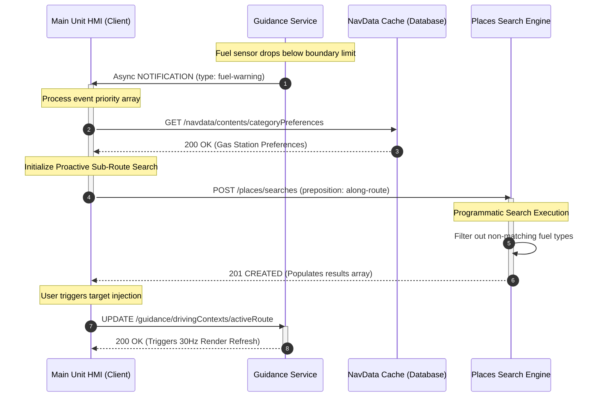

# MIB3 Connected Navigation System: API Data Schema & Sequence Specification

This technical documentation module contains architectural specifications, CRUD matrices, and cross-domain interaction models for the RESTful/WebSocket Service Interface (RSI/ViWi) running on the automotive MIB3 infotainment platform.

---

## 🏗️ Domain Service Architecture

The core navigation cluster is engineered as an event-driven middleware layer split into four independent, highly serialized resource domains:

```text
+-----------------------------------+

|        Main Unit HMI Client       |
+-----------------------------------+
                  |
+-----------------+-----------------+
| (REST / WebSockets over Vehicle Interface)
v                                   v
+---------------------+             +---------------------+

|  guidance.service   |             | maprenderer.service |
| ------------------- |             | ------------------- |
| - GNSS Car Tracking |             | - Viewport Matrices |
| - Maneuvers Logic   |             | - Layer Displace    |
| - Hazard Alerts     |             | - Touch targets     |
+---------------------+             +---------------------+

                  |                     |
+-----------------+-----------------+
|
v
+---------------------+             +---------------------+

|   navdata.service   |             |  tripview.service   |
| ------------------- |             | ------------------- |
| - User Profiles     |             | - Linear Trip Lines |
| - Favorites Database|             | - Stopover Detours  |
| - ETC Card Reader   |             | - Track Truncation  |
+---------------------+             +---------------------+
```

---

## 📊 Core Data Schema & CRUD Constraints

The table below catalogs structural properties, visibility parameters, and mutation constraints enforced across domain collections:

| Domain | Resource Elements | Data Type / Format | Mutation Constraints | Functional Lifecycle Description |
| :--- | :--- | :--- | :--- | :--- |
| **`guidance`** | `carPositions` | `object` (WGS84 JSON) | Read-Only (`READ_element`) | Dynamic GNSS tracking payload containing precision variables (`gdop`, `hdop`, `heading`) and raw telemetry maps. |
| | `drivingContexts` | `object` (`ref#routing`) | Update-Only (`UPDATE_settable`) | Contextual engine route state tracking active route paths, upcoming lanes configurations, and speech alert buffers. |
| | `handledNotifications` | `string` (UUID Mask) | Full CRUD (`CREATE / DELETE`) | High-priority safety events stack handling cross-client system alerts (`ghost-driver`, `tiredness-warning`). |
| **`maprenderer`** | `renderers` | `object` (Matrix JSON) | Full CRUD | Main viewport engine tracking canvas limits, camera boundaries (`zoomMode`), and active color arrays (`routeColor`). |
| | `geometricPrimitives` | `array[geoposition]` | Full CRUD | Structural shapes rendering point, line, and complex polygon overlays on vector-based map layers. |
| **`navdata`** | `contents` | `object` (`ref#places`) | Update-Only | Highly localized personal profile caches mapping vehicle license plates and market-specific card slots (`etcHistory`). |
| | `settings` | `boolean / enum` | Update-Only | Global user toggles defining route behavior masks (`isAvoidTollRoadsActive`, `isAvoidFerriesActive`). |
| **`tripview`** | `trips` | `object` (`ref#guidance`) | Read-Only | Abstract programmatic pipeline managing linear ahead-of-path UI lines, calculating trip deltas and timeline objects. |

---

## 🔄 Sequence Workflow: Contextual Telemetry & Proactive Search Gating

This transaction schema details the multi-service pipeline executed when an internal sensor alert triggers an asynchronous background search sequence, modifying active route parameters on-the-fly.



---

## 🌐 Globalization & Hardware Architecture Blocks

### 1. Japanese ETC Payment Tracking Module
The system isolates automated toll transaction parsing via high-integrity resource bindings inside the `navdata` microservice. Telemetry arrays map incoming physical logging logs (`navdata.contents.etcCardReaderInformation`) straight into live payment tables, tracking gate entry timestamps, highway indices (`entranceInterchangeHighwayName`), and dynamic refund validations.

### 2. Multi-Display Viewport Constraint Management
Multi-display output processing maps data layers identically across hardware displays while isolating local coordinate bounds. Rendering pipelines decouple background route evaluation calculations from physical hardware drawing limits. Viewport matrix changes trigger separate layout transitions based on target screen specifications (e.g., locking touch operations for secondary instrument clusters while maintaining standard pointer triggers on the main HMI canvas).
